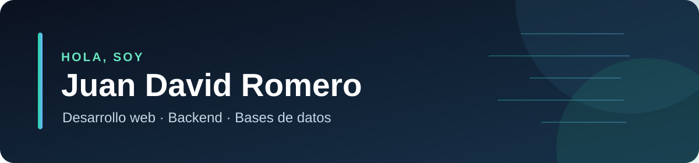

  

  <h2>Hola, soy Juan David Romero</h2>

  
<strong>Estudiante de la Universidad Distrital Francisco José de Caldas</strong> 
  Desarrollo interfaces web, servicios backend y herramientas para modelar sistemas.

  

    
    
  

## Sobre mí

- 🎓 Estudio en la **Universidad Distrital Francisco José de Caldas**.
- 🔭 Actualmente colaboro en **[HiLeS Web](https://github.com/KevMasMas/HiLeS_WEB)**, un editor y simulador conectado con dispositivos físicos.
- 🧩 He trabajado en editores visuales, redes de Petri, APIs REST, bases de datos e integración MQTT.
- 📫 Contacto: **[juandavidromero2003@gmail.com](mailto:juandavidromero2003@gmail.com)**.

## Lenguajes y herramientas

**Lenguajes y web**

  
  
  
  
  

**Frameworks, datos e integración**

  
  
  
  
  
  
  

También: Express, MQTT/Mosquitto, pruebas automatizadas y modelado relacional. Iconos de <a href="https://github.com/devicons/devicon">Devicon</a>.

## Proyectos destacados

### [HiLeS Web](https://github.com/KevMasMas/HiLeS_WEB) · 2026–actualidad

**Qué hace:** editor y simulador web de modelos HiLeS. Permite construir circuitos con bloques y conexiones, simular redes de Petri en el navegador y comunicar la aplicación con una Raspberry Pi Pico W mediante MQTT y Mosquitto para ejecutar y observar modelos fuera del navegador.

**Mi aporte:**

- Construí y mejoré el editor visual en React y TypeScript: componentes y conexiones, rutas, zoom, movimiento del canvas, deshacer y rehacer, persistencia del proyecto y organización de paneles.
- Implementé la lógica de lugares y transiciones de redes de Petri en el motor de simulación.
- Integré mensajes MQTT con los elementos `Service` y alineé el contrato web con los mensajes de la Pico W; añadí pruebas para el puente y los mensajes.
- Trabajé en la interfaz de colaboración para móvil y en pruebas de ejecución distribuida y conformidad del modelo IR v2 en la rama `multi-pico`.
- En una etapa inicial diseñé un prototipo de persistencia con NestJS y Prisma; la versión actual del proyecto funciona sin ese backend.
- Preparé documentación técnica y ejemplos para reproducir y validar el trabajo.

[Ver mis commits en `main`](https://github.com/KevMasMas/HiLeS_WEB/commits/main/?author=Juandav08) · [Ver trabajo en `multi-pico`](https://github.com/KevMasMas/HiLeS_WEB/tree/multi-pico)

### [Plataforma de adopción de mascotas](https://github.com/UDFJDC-ModelosProgramacionBackup/MP_202510_G81_E1_AdopcionMascotas_Back) · 2025

**Qué hace:** backend REST en Java y Spring Boot para gestionar mascotas, refugios, solicitudes de adopción, adopciones y su seguimiento. El modelo también incluye veterinarios y eventos médicos.

**Mi aporte:** desarrollé y refactoricé controladores y operaciones CRUD; trabajé en servicios, manejo de errores y pruebas relacionadas con adopciones y veterinarios. [Mi fork](https://github.com/Juandav08/adopcion-mascotas-backend) conserva el enlace al repositorio original del curso.

### [11Leven](https://github.com/Juandav08/11Leven) · 2026

**Qué hace:** aplicación web académica para consultar y administrar partidos, selecciones, jugadores y alineaciones del Mundial 2026. Muestra los titulares sobre una cancha, organiza encuentros por grupos y rondas, y ofrece un panel de administración.

**Mi aporte:** desarrollé el frontend con HTML, CSS y JavaScript, la API REST con Node.js y Express y el modelo relacional en MySQL. Incorporé operaciones CRUD, validaciones, notificaciones internas e importación de datos disponibles de FIFA.

  En los proyectos de equipo, los enlaces llevan al repositorio original para reconocer el trabajo compartido.

